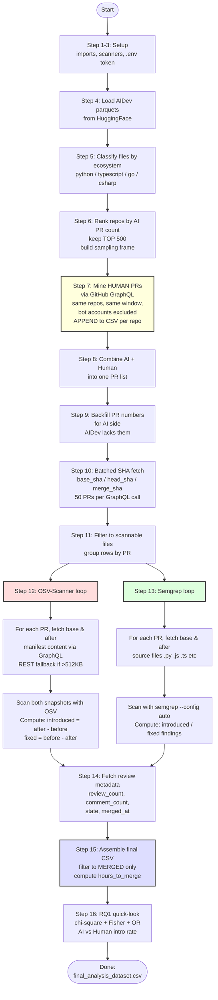

# AI-Agent vs Human PR Vulnerability Pipeline — Overview
## Table of Contents

1. [The Research Question](#1-the-research-question)
2. [Background: What is AIDev?](#2-background-what-is-aidev)
3. [Background: The Tools](#3-background-the-tools)
4. [End-to-End Flowchart](#4-end-to-end-flowchart)
5. [Step-by-Step Breakdown](#5-step-by-step-breakdown)
6. [Data Artifacts Produced](#6-data-artifacts-produced)
7. [Why Each Design Choice Matters](#7-why-each-design-choice-matters)
8. [Expected Outputs](#8-expected-outputs)

---

## 1. The Research Question

> **When an AI coding agent modifies a project's dependencies, does it introduce known-vulnerable packages at a different rate — and with different severity — than a human developer performing the same task?**

This matters because:
- AI agents (Copilot, Cursor, Devin, Claude Code, OpenAI Codex) now open and merge real PRs in production repositories
- They're often rubber-stamped by reviewers who trust the agent's output
- If they introduce vulnerabilities at a higher rate, we need to know

The paper's answer: **AI-agent PRs introduce vulnerabilities at ~2× the odds of human PRs** (17.17% vs. 9.14%), and the ones they introduce skew **more severe** (36.8% critical vs. 20.5% for humans).

---

## 2. Background: What is AIDev?

**AIDev** (and its curated subset **AIDev-Pop**) is a research dataset published on HuggingFace by **Hao Li et al.** at `hao-li/AIDev`.

### What's in it

| File | Contents | Why we need it |
|---|---|---|
| `pull_request.parquet` | Every PR authored by an AI agent on a public GitHub repo (>100★) | Source of the "AI side" of our comparison |
| `pr_commit_details.parquet` | One row per file changed in each PR | Tells us which PRs touched dependency manifests |
| `repository.parquet` | Metadata for every repo in the dataset | Maps `repo_id` to `owner/name` |

### How AIDev identifies AI-authored PRs

Li et al. identified PRs by:
- GitHub user accounts for known agents (`cursor[bot]`, `devin-ai-integration[bot]`, `openai-codex`, etc.)
- Commit metadata and PR descriptions indicating AI authorship (Copilot "co-authored by" trailers)
- Repository integrations that flag the agent

### AIDev-Pop subset we actually use

- **9,509 total repositories** in AIDev containing AI-agent manifest-touching PRs
- **~58,000 unique AI PRs** across the full dataset
- 5 agents represented:
  - **Devin**
  - **OpenAI Codex**
  - **Copilot**
  - **Cursor**
  - **Claude Code**

### Why we filter down to the top 500

Scanning every one of the 9,509 repos is **prohibitively slow** (many hours just for Step 7's human-PR mining). Most repos contribute only 1-2 AI PRs — not enough signal to be worth the API calls.

**Our ranking strategy**:
- Group AIDev's AI PRs by repo, count unique `pr_id`s per repo
- Keep the top 500 repos by AI PR count
- Result: **500 repos covering ~29,000 AI PRs (≈50% of the total)** with a minimum of 21 AI PRs per repo

This is a **~95% reduction in repo count** while retaining **50% of all AI PR signal** — a very efficient trade-off. The paper itself works with roughly this density of data per repo.

Set `N_REPOS = None` in Step 6 if you want the full 9,509-repo scope instead.

### Why we trust it

It's a **published**, **versioned**, **openly-downloadable** dataset — and our pipeline mines the matched human-authored baseline **fresh** from GitHub each run, so the human side is never stale.

---

## 3. Background: The Tools

### 3.1 OSV-Scanner

- **What it is**: Google's open-source vulnerability scanner
- **What it does**: Reads a dependency lockfile (e.g. `package-lock.json`), resolves every package version, and queries [OSV.dev](https://osv.dev) — an aggregated database of known vulnerabilities covering CVEs, GHSAs, GSD, RustSec, etc.
- **Output**: JSON listing every vulnerable package with its CVE/GHSA ID and severity (LOW / MODERATE / HIGH / CRITICAL)
- **Why it matters**: It scans **declared dependencies**, so it finds supply-chain risks — the kind introduced when an AI agent bumps `lodash` to a version with a known prototype-pollution bug
- **What it can't do**: It doesn't look at source code at all. A SQL injection the author wrote by hand in `app.py` is invisible to OSV

### 3.2 Semgrep

- **What it is**: A static-analysis tool that pattern-matches **source code** against vulnerability rules
- **What it does**: Runs a ruleset (`--config auto` pulls community + registry rules) over `.py`, `.js`, `.ts`, `.go`, `.java`, etc. — flagging things like:
  - Hardcoded secrets (AWS keys, tokens)
  - SQL injection / command injection sinks
  - Insecure deserialization
  - XSS patterns
  - Weak cryptography
- **Output**: JSON listing each finding with `check_id`, severity, file, line number
- **Why it matters**: Catches the vulnerabilities **OSV misses** — bad code the agent wrote, not just a bad package it depended on
- **What it can't do**: It doesn't know about CVE databases; it only matches syntactic patterns

### 3.3 GitHub GraphQL API

- Used for **90% of data fetching** in this pipeline
- Two reasons we prefer it over the REST API:
  1. **Batching with aliases** — one request fetches 50 PRs' worth of data instead of 50 requests
  2. **Field selection** — we only pay (in rate-limit quota) for fields we actually need
- Rate limit: 5,000 "points" per hour (points ≈ the cost of each field requested)
- Falls back to REST for files larger than 512 KB (a GraphQL blob text limit)

### 3.4 Why OSV + Semgrep together

| Concern | OSV-Scanner | Semgrep |
|---|---|---|
| Vulnerable dependency added | ✅ Catches | ❌ Misses |
| SQL injection in new code | ❌ Misses | ✅ Catches |
| Hardcoded AWS key | ❌ Misses | ✅ Catches |
| Version bump to patched release | ✅ Flags as "fixed" | ❌ Blind |
| Regex-based XSS | ❌ Misses | ✅ Catches |

Using both gives us a **complete picture** of the security change a PR introduces.

---

## 4. End-to-End Flowchart



---

## 5. Step-by-Step Breakdown

### Step 1 — Imports and workspace paths
- Standard library + `pandas`, `requests`
- `WORK_DIR` points to `AIAgentVulnPipeline/data/` — every output lives there
- Declares every artifact filename up front so you know what will be created

**Output**: nothing yet, but all paths are reserved

---

### Step 2 — Install OSV-Scanner + Semgrep
- Downloads `osv-scanner_windows_amd64.exe` from GitHub releases → `data/osv-scanner.exe`
- `pip install semgrep` (Python package)
- Verifies both work with `--version`

**Output**: `osv-scanner.exe` in your workspace

---

### Step 3 — Load GitHub token from `.env`
- Reads `GITHUB_TOKEN=...` from `.env` in the notebook's folder
- Falls back to `GITHUB_TOKEN` environment variable
- Prints masked preview + remaining rate limit

**Output**: `HEADERS` dict for all downstream API calls

---

### Step 4 — Load AIDev parquets from HuggingFace
- `pd.read_parquet("hf://datasets/hao-li/AIDev/...")` — direct HTTP, no HF account needed
- Three dataframes loaded into memory:
  - `commit_details` (~hundreds of thousands of file-change rows)
  - `pull_requests` (~tens of thousands of PR rows)
  - `repository` (~thousands of repo rows)

**Output**: in-memory dataframes

---

### Step 5 — Classify dependency files by ecosystem
- Regex-match every filename in `commit_details` against 4 ecosystems
- Drop non-matches → keep only manifest-touching rows
- Join with PR metadata + repo full_name
- Save as `ai_manifest_touching_prs.csv`

**Example**: `requirements.txt` → `python`, `package-lock.json` → `typescript`, `foo.py` → `None` (dropped)

**Output**: `ai_manifest_touching_prs.csv`

---

### Step 6 — Rank repos + build sampling frame (TOP 500 by default)
- **Rank** all repos in AIDev by **unique AI PR count** (descending)
- **Keep the top `N_REPOS`** (default `500`) — covers ~50% of all AI PRs with ~5% of the repos
- `repo_paths`: dict `{repo_full_name: [manifest_paths]}` — only for selected repos, in rank order
- `global_since` / `global_until`: the AIDev time window
- `bot_exclusions`: set of usernames to skip on the human side (every known AI agent + dependabot + renovate)
- Prints the top 10 selected repos + min PRs threshold so you can verify the cut

**Knob**:
```python
N_REPOS = 500   # or None for full 9,509-repo scope
```

**Why rank by AI PR count?** Low-activity repos (1-2 AI PRs) cost the same GraphQL quota to mine as high-activity ones but contribute almost no statistical signal. Ranking concentrates effort where the signal is.

**Why matched sampling**: We mine human PRs from **the exact same repos** AI agents touched. Repo-level confounders (team culture, test coverage, ecosystem) cancel out.

---

### Step 7 — Mine human PRs via GitHub GraphQL ⚠️ **SLOWEST STEP**
For each of the top 500 repos:
1. Paginate through merged PRs (newest first, 50 per page)
2. Stop paging when PR `createdAt` < `global_since`
3. Skip any PR authored by a bot or AI agent (`bot_exclusions`)
4. Intersect each PR's file list with `paths_of_interest` (the manifest files AI agents touched in this repo)
5. Buffer matching rows in memory for **this repo only**

**Append-mode checkpointing** (updated):
- After each repo completes, buffered rows are **appended** to `human_manifest_touching_prs.csv` with `mode="a", header=False` — the full file is never rewritten
- The repo name is appended to `human_mining_done_repos.txt`
- Memory usage stays flat regardless of how many repos are already done
- On resume: skips repos in the done-file, counts existing CSV lines for display (no load into RAM)

**Expected runtime**: ~30-60 minutes for the top 500 repos (vs. several hours for the full 9,509)

**Output**: `human_manifest_touching_prs.csv` (grown incrementally, one repo at a time)

---

### Step 8 — Combine AI + human sides
- Union both sides into `all_prs_needing_sha` with columns: `pr_id`, `full_name`, `number`, `side`
- Human side already has PR numbers (mined above)
- AI side has `pr_id` only — the next step backfills numbers

---

### Step 9 — Backfill PR numbers for the AI side
- AIDev stores GitHub's internal `databaseId`, not the repo-scoped PR number (`/pull/1234`)
- For each repo with AI PRs, paginate merged PRs, match by `databaseId`, record the `number`
- Save as `ai_pr_numbers.csv`

**Why**: The next step's GraphQL query looks up PRs by number, so we need it.

---

### Step 10 — Batched SHA fetch
For each PR we need three commit SHAs:
- `baseRefOid` — the commit the PR branched **from** → the "before" state
- `mergeCommit.oid` — the merge commit → the "after" state (primary)
- `headRefOid` — the PR branch head → fallback when `mergeCommit` is null

**Batching trick**: 50 PRs per GraphQL request via field aliases:
```graphql
query {
  repository(owner: "x", name: "y") {
    pr0: pullRequest(number: 1) { baseRefOid headRefOid mergeCommit { oid } }
    pr1: pullRequest(number: 2) { baseRefOid headRefOid mergeCommit { oid } }
    ...
    pr49: pullRequest(number: 50) { baseRefOid headRefOid mergeCommit { oid } }
  }
}
```
This cuts API calls by ~50×.

**Output**: `all_pr_shas.csv`

---

### Step 11 — Filter to scannable files + group by PR
Not every manifest is scannable by OSV. Only these are:
- `poetry.lock`, `requirements*.txt`
- `package-lock.json`, `yarn.lock`, `pnpm-lock.yaml`
- `go.mod`
- `packages.lock.json` (C#)

**Why not `package.json` or `pyproject.toml` alone?**
Those have unpinned version ranges (`^1.2.0`). OSV needs concrete versions, which only lockfiles provide.

Then group row-by-row manifest touches into **one row per PR** — the unit we scan.

**Output**: in-memory `all_pr_groups` dataframe

---

### Step 12 — OSV-Scanner loop ⚠️ **HEAVY STEP**
For each PR:
1. For each manifest file:
   - GraphQL-fetch content at `base_sha` → `base_text`
   - GraphQL-fetch content at `after_sha` → `after_text`
   - If GraphQL truncated (>512 KB) → REST fallback to `/contents/{path}` with `download_url`
2. Write both to temp files
3. Run `osv-scanner scan --format json` on each
4. Parse: `{vuln_id: severity}` for each
5. Compute:
   - `introduced = set(after) - set(before)` — vulns this PR added
   - `fixed = set(before) - set(after)` — vulns this PR removed

**Checkpointed every 25 PRs** → `osv_scan_results.csv`

**Output columns**:
- `pr_id, side, agent, full_name, ecosystems`
- `num_files_scanned, before_count, after_count`
- `introduced_count, fixed_count`
- `introduced_ids, introduced_severities`
- `scan_had_error`

---

### Step 13 — Semgrep loop
Same pattern as OSV, but for source code:
1. GraphQL-fetch the **file list** of the PR
2. Filter to source extensions (`.py`, `.js`, `.ts`, `.go`, etc.)
3. Cap at 10 source files per PR (prevents giant PRs from blowing up runtime)
4. Fetch base/after content
5. Run `semgrep scan --config auto --json`
6. Parse `check_id` + severity per finding
7. Compute `introduced` / `fixed` on the set of `{check_id}@{filename}` keys

**Checkpointed every 10 PRs** → `semgrep_scan_results.csv`

**Output columns**: `pr_id, side, agent, full_name, num_source_files_scanned, sg_before_count, sg_after_count, sg_introduced_count, sg_fixed_count, sg_introduced_severities`

---

### Step 14 — Review + merge-time metadata
For the exploratory analysis we need:
- `state` → to filter `MERGED` only
- `created_at` / `merged_at` → `hours_to_merge`
- `review_count` → number of code reviews
- `comment_count` → number of top-level PR comments

Batched 50 PRs per GraphQL call (same aliasing trick).

**Output**: `review_metadata.csv`

---

### Step 15 — Final assembly
```python
final = osv_df
         .merge(sg_df, on="pr_id", how="left")
         .merge(review_df, on="pr_id", how="left")
         [final.state == "MERGED"]
final["hours_to_merge"] = (merged_at - created_at).hours
```

Prints:
- Side breakdown (AI vs Human counts)
- Per-agent breakdown (Devin, Copilot, Cursor, Codex, Claude)
- Introduced-vuln rate per side (OSV)
- Introduced-finding rate per side (Semgrep)

**Output**: `final_analysis_dataset.csv` — analysis-ready

---

### Step 16 — RQ1 quick-look
2×2 proportion test on `(side, has_introduced_vuln)`:
- **Chi-square** with Yates' correction
- **Fisher's exact** (more robust for small cells)
- **Odds ratio** with 95% CI

Prints the AI vs Human introduction rates side-by-side. Expected AI OR ~2.06 if you've run the full scope.

---

## 6. Data Artifacts Produced

Every file lives in `AIAgentVulnPipeline/data/`:

| Filename | Produced by | Write mode | Purpose |
|---|---|---|---|
| `ai_manifest_touching_prs.csv` | Step 5 | overwrite | AI side raw |
| `human_manifest_touching_prs.csv` | Step 7 | **append** | Human side raw (one block per repo) |
| `human_mining_done_repos.txt` | Step 7 | **append** | Resume checkpoint (one repo per line) |
| `ai_pr_numbers.csv` | Step 9 | overwrite | AI PR number lookup |
| `all_pr_shas.csv` | Step 10 | overwrite | Commit SHAs for both sides |
| `osv_scan_results.csv` | Step 12 | overwrite every 25 PRs | Dependency vulns per PR |
| `osv_scan_done_ids.txt` | Step 12 | overwrite | Resume checkpoint |
| `semgrep_scan_results.csv` | Step 13 | overwrite every 10 PRs | Code findings per PR |
| `semgrep_scan_done_ids.txt` | Step 13 | overwrite | Resume checkpoint |
| `review_metadata.csv` | Step 14 | overwrite per batch | Review/merge metadata |
| **`final_analysis_dataset.csv`** | Step 15 | overwrite | **The output** |
| `*.log` | Multiple | append | Failure logs for debugging |

---

## 7. Why Each Design Choice Matters

### Why **top-500 by AI PR count** instead of all 9,509 repos?
- Repos with only 1-2 AI PRs cost the same quota to mine as repos with hundreds. Keeping them is a bad return on investment.
- The top 500 cover **50% of all AI PRs** in AIDev with only **5% of the repos** — a 10× efficiency gain.
- Statistical signal is concentrated where AI agents are actually active (big projects: `openclaw`, `github/gh-aw`, `airbytehq/airbyte`, `dotnet/runtime`, etc.).
- Set `N_REPOS = None` for a full 9,509-repo run if you want to replicate the paper exactly.

### Why **matched sampling** (same repos, same window)?
If we compared AI PRs in bleeding-edge React repos against human PRs in sleepy enterprise Java repos, differences would be driven by ecosystem/repo culture — not AI vs. human. Matching eliminates this.

### Why **merged-only**?
An unmerged PR introduces nothing — its vulnerabilities are hypothetical. We only count what actually landed in production codebases.

### Why **both base and after**, not just after?
A PR that updates `lodash` from a vulnerable version to a safe one would look "bad" if we only scanned the after-state (lodash is still there). Measuring `after - before` correctly attributes it as **fixing** a vulnerability, not introducing one.

### Why **append-mode CSV writes** in Step 7?
- The old approach (`pd.DataFrame(results).to_csv(path)`) rewrote the *entire* file after every repo. As the CSV grew, each checkpoint took longer than the last — an O(N²) problem.
- The new approach uses `pd.DataFrame(repo_rows).to_csv(path, mode="a", header=False)` — only *this repo's* rows are serialized, appended, then released from memory.
- Memory usage stays **flat** regardless of dataset size.
- Checkpoint time stays **constant** regardless of how many repos are already done.
- Resume logic doesn't `read_csv()` the file into memory — just counts lines for display.

### Why **checkpoint everything**?
Even a 500-repo run takes ~30-60 minutes. API hiccups, rate limits, local crashes — all expected. Every loop writes to disk incrementally so re-running picks up exactly where you left off.

### Why **batched GraphQL (50 per call)**?
GitHub's 5,000-points-per-hour budget would last ~90 seconds against tens of thousands of PRs if each got its own call. Batching 50:1 stretches that to ~75 minutes of quota — enough to finish most repos in a single quota window.

### Why **no helper functions in notebook cells**?
Per your request: every operation is inline so you can read each cell top-to-bottom, pause mid-loop, inspect intermediate state via `df.head()`, and understand exactly what's happening without jumping between cells.

---

## 8. Expected Outputs

After the **top-500 run**, your `final_analysis_dataset.csv` should look roughly like:

```
pr_id      side   agent   full_name         ecosystems   introduced_count  sg_introduced_count  review_count  hours_to_merge
123456     ai     devin   openclaw/openclaw python       2                 0                    3             16.4
123457     human  human   openclaw/openclaw python       0                 1                    1             4.2
123458     ai     copilot github/gh-aw      typescript   0                 0                    5             28.9
...
```

### Approximate sizes by scope

| Scope | Repos | AI PRs | Human PRs | Runtime |
|---|---|---|---|---|
| **Top 500 (default)** | 500 | ~29,000 | ~8,000-15,000 (depends on repo activity) | ~30-60 min for Step 7 |
| Full AIDev | 9,509 | ~58,000 | ~16,000+ (paper reports 16,504) | Several hours for Step 7 |

### Headline statistics the paper reports (full-scope reference)
- Pooled AI intro rate: **17.17%**
- Pooled human intro rate: **9.14%**
- Pooled OR (AI vs human): **2.06** [95% CI 1.76-2.41], p = 3.8×10⁻¹⁷
- Python ecosystem: AI 23.33% vs Human 8.34%, OR 3.34
- TypeScript: AI 17.79% vs Human 9.60%, OR 2.04
- Severity: 36.8% of AI-introduced vulns are CRITICAL vs 20.5% for human
- AI PRs receive **more** reviews and **take longer** to merge — the gap persists despite scrutiny

### What to expect from the top-500 run
Direction should replicate (AI > human intro rate; AI skews more severe), but confidence intervals will be **wider** than the paper's because:
- Our sample is roughly half the size
- We add Semgrep findings, which the paper doesn't
- Our time window is a snapshot of AIDev as of today, not the exact window Li et al. published

The top-500 is explicitly a **replication-at-reduced-cost** run, not a full reproduction.

---

## 9. Caveats

- **Observational**: AI vs. human assignment is not randomized. We report associations, not causation.
- **C# excluded**: OSV needs pinned lockfiles. NuGet's `packages.lock.json` is opt-in and rare — only ~3% of C# PRs are scannable. We retain C# rows but exclude them from scanning analysis.
- **Go underpowered**: Only ~4 positive AI cases in the Go stratum. Reported as inconclusive, not a reversal.
- **Semgrep `--config auto`**: pulls community rules. Different ruleset → different findings count. Not a problem for *relative* AI vs. human comparison (both scanned the same way).
- **Present-day vulnerability status**: We measure vulnerabilities as *currently known*, not *as of the PR's merge date*. This measures realized risk exposure — a design choice, not a bug.

---

## 10. Quick Start

```bash
cd C:\Users\abhinandan.shrestha\Documents\Test\AIAgentVulnPipeline

# 1. Create .env with your GitHub token
echo "GITHUB_TOKEN=ghp_your_actual_token" > .env

# 2. Launch Jupyter
jupyter notebook AI_Agent_Vuln_Pipeline.ipynb

# 3. Cell -> Run All
# 4. Wait (hours for full scope; minutes if you set MAX_REPOS=5)
# 5. Inspect data/final_analysis_dataset.csv
```

---

## References

- **Paper**: ahmadmustafa02 et al. (2026). *Software Security During AI-Assisted Software Development: A Case Study of Dependency Vulnerability Introduction in AI-Agent-Authored Pull Requests*. IEEE Access.
- **Original repo**: https://github.com/ahmadmustafa02/ai-agent-dependency-vulns
- **AIDev dataset**: Li et al. — https://huggingface.co/datasets/hao-li/AIDev
- **OSV-Scanner**: Google — https://github.com/google/osv-scanner
- **OSV.dev**: The vulnerability database behind OSV-Scanner — https://osv.dev
- **Semgrep**: https://semgrep.dev
- **GitHub GraphQL API**: https://docs.github.com/en/graphql
