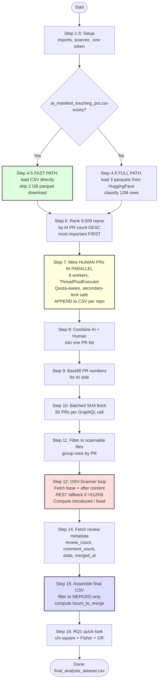

# AI-Agent vs Human PR Dependency Vulnerability Pipeline

## Table of Contents

1. [Quick Start](#1-quick-start)
2. [The Research Question](#2-the-research-question)
3. [Which Notebook Should I Use?](#3-which-notebook-should-i-use)
4. [The Complete Analysis Workflow](#4-the-complete-analysis-workflow)
5. [Background: What is AIDev?](#5-background-what-is-aidev)
6. [Background: The Tools](#6-background-the-tools)
7. [End-to-End Flowchart](#7-end-to-end-flowchart)
8. [Step-by-Step Breakdown](#8-step-by-step-breakdown)
9. [Data Artifacts Produced](#9-data-artifacts-produced)
10. [Rate-Limit & Resilience Strategy](#10-rate-limit--resilience-strategy)
11. [Why Each Design Choice Matters](#11-why-each-design-choice-matters)
12. [Expected Outputs](#12-expected-outputs)
13. [Caveats](#13-caveats)

---

## 1. Quick Start

The full analysis is **two notebooks run in sequence**:

```bash
cd C:\Users\abhinandan.shrestha\Documents\Test\AIAgentVulnPipeline

# 0. Create .env with your GitHub Personal Access Token (public_repo read scope)
echo "GITHUB_TOKEN=ghp_your_actual_token" > .env

# -------------------------------------------------------------------
# Step A: MINE PR DATA (slow, ~10-15 hours for all 9,509 repos)
# -------------------------------------------------------------------
jupyter notebook AI_Agent_Vuln_Pipeline_Fast.ipynb
# Cell -> Run All. Produces:
#   data_fast/ai_manifest_touching_prs.csv        (AI-side PR metadata)
#   data_fast/human_manifest_touching_prs.csv     (matched human PRs)

# -------------------------------------------------------------------
# Step B: SCAN + COMPARE (~2 hours for 1000 AI + 1000 Human sample)
# -------------------------------------------------------------------
jupyter notebook Scan_And_Compare.ipynb
# Cell -> Run All. Produces:
#   data_scan/final_scan_dataset.csv              (PRs + OSV + Semgrep scan results)
#   data_scan/comparison_reports/*.csv            (DuckDB SQL comparison tables)
#   + prints final verdict with chi-square / Fisher / odds-ratio
```

| Stage | Runtime | Output |
|---|---|---|
| **A. Mining** (Fast notebook, 9,509 repos) | 10-15 hours | 2 intermediate CSVs with PR metadata |
| **B. Scan + Compare** (1000 AI + 1000 Human, matched) | ~2 hours | Final dataset + statistical verdict |

Both notebooks are **fully resumable** — safe to interrupt and restart.

---

## 2. The Research Question

> **When an AI coding agent modifies a project's dependencies, does it introduce known-vulnerable packages at a different rate — and with different severity — than a human developer performing the same task?**

This matters because:
- AI agents (Copilot, Cursor, Devin, Claude Code, OpenAI Codex) now open and merge real PRs in production repositories
- They're often rubber-stamped by reviewers who trust the agent's output
- If they introduce vulnerabilities at a higher rate, we need to know

**Expected outcome of our finding** (if the paper's effect replicates on our sample): AI-agent PRs should introduce vulnerabilities at **~2× the odds of human PRs**, and the ones they introduce should skew **more severe** (CRITICAL/HIGH proportionally higher for AI than for humans). Our run may land anywhere inside a wider confidence interval because we use a 2,000-PR matched sample plus Semgrep in addition to OSV.

---

## 3. Which Notebook Should I Use?

There are **four notebooks** in this folder, falling into two groups:

### Group A — Mining (produces PR metadata CSVs)

| Feature | `AI_Agent_Vuln_Pipeline.ipynb` (original) | `AI_Agent_Vuln_Pipeline_Fast.ipynb` ⚡ (recommended) |
|---|---|---|
| **Scope default** | Top 500 repos (`N_REPOS = 500`) | **All 9,509 repos** (`N_REPOS = None`) |
| **Human mining** | Sequential (one repo at a time) | **Parallel** (`ThreadPoolExecutor`, 8 workers) |
| **Semgrep scan** | Yes (slow, ~2h) | **Skipped** (paper doesn't use Semgrep) |
| **Rate-limit strategy** | Basic | **Pre-flight check + quota floor + soft throttle + secondary-limit retry** |
| **Progress output** | Every repo | Every 25 repos (flood control) |
| **CSV writes** | Append-mode | Append-mode (thread-safe via `csv_lock`) |
| **Writes to** | `data/` | `data_fast/` (separate folder, won't collide) |
| **Fast-path reuse** | No | **Yes** — reuses `ai_manifest_touching_prs.csv` and `osv-scanner.exe` from `data/` if present |
| **Full-scope runtime** | 10+ hours (slow single-thread) | **10-15 hours** (dominated by rate limits, not code) |

### Group B — Scanning + Comparison (produces vuln findings + verdict)

| Notebook | Purpose | Reads | Writes |
|---|---|---|---|
| **`Scan_And_Compare.ipynb`** ⭐ | **End-to-end scan + compare.** Samples 1000 AI + 1000 Human PRs from matched top-1000 repos, runs OSV + Semgrep, computes verdict via DuckDB SQL. | `data_fast/*_manifest_touching_prs.csv` | `data_scan/final_scan_dataset.csv`<br>`data_scan/comparison_reports/*.csv` |
| `Comparison_Analysis.ipynb` | **Comparison-only.** Reads whichever `final_analysis_dataset.csv` already exists (from the original slow notebook). Does not perform any scanning. | `data/final_analysis_dataset.csv` or `data_fast/final_analysis_dataset.csv` | `comparison_reports/*.csv` |

**Recommended workflow**:
1. **`AI_Agent_Vuln_Pipeline_Fast.ipynb`** → mine PR metadata (one time, ~10-15h)
2. **`Scan_And_Compare.ipynb`** → sample + scan + compare (~2h) → **get your verdict**

The original slow notebook is kept as the canonical reference implementation; `Comparison_Analysis.ipynb` is for anyone who ran the original slow notebook and wants a pure-SQL comparison layer on top of its output.

---

## 4. The Complete Analysis Workflow

The whole pipeline is a **two-stage flow**. The split exists because mining (Stage A) is slow and quota-bound while scanning + comparison (Stage B) is CPU-bound — keeping them separate means you can re-run Stage B many times without re-mining.

```
┌──────────────────────────────────────────────────────────────────────┐
│ STAGE A — MINE (AI_Agent_Vuln_Pipeline_Fast.ipynb)                   │
│                                                                      │
│ AIDev parquets → classify ecosystems → rank 9509 repos by AI PR count│
│         ↓                                                            │
│ For each repo in priority order (8 parallel workers):                │
│   GraphQL paginate merged PRs → filter bots → intersect manifests    │
│         ↓                                                            │
│ APPEND to CSV per repo (rate-limit-safe, resumable)                  │
│         ↓                                                            │
│ ARTIFACTS:                                                           │
│   • data_fast/ai_manifest_touching_prs.csv    (~360K rows)           │
│   • data_fast/human_manifest_touching_prs.csv (~1M+ rows)            │
└──────────────────────────────────────────────────────────────────────┘
                                 ↓
┌──────────────────────────────────────────────────────────────────────┐
│ STAGE B — SCAN + COMPARE (Scan_And_Compare.ipynb)                    │
│                                                                      │
│ Sample: rank repos → keep top 1000 (must have both AI + Human PRs)   │
│         → pick 1 most-recent AI PR + 1 most-recent Human PR per repo │
│         → ~1000 AI + ~1000 Human PRs, matched by repo                │
│         ↓                                                            │
│ Fetch commit SHAs (base / head / merge), batched 50/call             │
│         ↓                                                            │
│ For each PR:                                                         │
│   OSV:     fetch lockfile content BEFORE + AFTER → osv-scanner scan  │
│            → introduced = after_vulns − before_vulns                 │
│   Semgrep: fetch PR source files → scan both versions                │
│            → introduced findings = after − before                    │
│         ↓                                                            │
│ Merge OSV + Semgrep results on pr_id → final_scan_dataset.csv        │
│         ↓                                                            │
│ DuckDB SQL analysis:                                                 │
│   • AI vs Human introduction rate (both scanners, side-by-side)      │
│   • Per-ecosystem pivot (python/typescript/go/csharp)                │
│   • Per-agent breakdown (Copilot/Devin/Cursor/Codex/Claude)          │
│   • Severity distribution (CRITICAL/HIGH/MODERATE/LOW)               │
│   • Scanner agreement (OSV ∩ Semgrep on same PRs)                    │
│         ↓                                                            │
│ Statistical tests: chi-square + Fisher's exact + odds ratio + 95% CI │
│         ↓                                                            │
│ FINAL VERDICT printed to notebook + saved as CSVs:                   │
│   • data_scan/comparison_reports/osv_side_summary.csv                │
│   • data_scan/comparison_reports/semgrep_side_summary.csv            │
└──────────────────────────────────────────────────────────────────────┘
```

### Why two stages instead of one monolithic notebook?

- **Mining takes 10-15 hours** and is dominated by GitHub rate limits — you want it to run once, overnight, and never again
- **Scanning takes ~2 hours** and you may want to **rerun it with different sampling parameters** (bigger sample, different repo ranking, different scanners)
- Keeping them separate means you can **tune the comparison without re-mining**
- The intermediate CSVs are small enough to version in git if you want to share

### What you actually see at the end of Stage B

After running `Scan_And_Compare.ipynb`, the final cells print:

```
======================================================================
RESEARCH QUESTION — FINAL VERDICT
======================================================================

Q: Do AI-authored PRs introduce vulnerabilities at a different rate
   than human-authored PRs in the SAME repositories?

OSV-SCANNER (dependency vulnerabilities):
   AI PRs:    XX.XX% introduction rate
   Human PRs: YY.YY% introduction rate
   AI is Z.ZZx MORE likely (OR)
   95% CI: [...]
   p = X.XXe-XX (statistically significant)

SEMGREP (source-code patterns):
   AI PRs:    XX.XX% introduction rate
   Human PRs: YY.YY% introduction rate
   AI is Y.YYx MORE likely (OR)
   ...

----------------------------------------------------------------------
PAPER REFERENCE (for comparison):
   AI OSV rate:    17.17% vs Human 9.14%
   Odds ratio:     2.06 [95% CI 1.76 - 2.41], p = 3.8e-17
   (Paper used OSV only; no Semgrep.)

CONCLUSION: Both scanners agree → AI introduces MORE vulnerabilities than Human.
```

Plus intermediate tables for per-ecosystem, per-agent, severity breakdown, and scanner agreement.

---

## 5. Background: What is AIDev?

**AIDev** (and its curated subset **AIDev-Pop**) is a research dataset published on HuggingFace by **Hao Li et al.** at [`hao-li/AIDev`](https://huggingface.co/datasets/hao-li/AIDev).

### What's in it

| File | Contents | Columns we use |
|---|---|---|
| `pull_request.parquet` | Every PR authored by an AI agent on a public GitHub repo (>100★) | `id`, `agent`, `repo_id`, `user`, `created_at`, `merged_at` |
| `pr_commit_details.parquet` | One row per file changed in each PR (~12M rows, ~2 GB) | `pr_id`, `filename` |
| `repository.parquet` | Metadata for every repo in the dataset | `id`, `full_name` |

### How AIDev identifies AI-authored PRs

Li et al. identified PRs by:
- GitHub user accounts for known agents (`cursor[bot]`, `devin-ai-integration[bot]`, `openai-codex`, etc.)
- Commit metadata and PR descriptions indicating AI authorship (Copilot "co-authored by" trailers)
- Repository integrations that flag the agent

### AIDev-Pop subset we use

- **9,509 total repositories** containing AI-agent manifest-touching PRs
- **57,976 unique AI PRs** across 6 agents:

| Agent | PRs in dataset |
|---|---|
| Claude Code | 172,597 |
| Copilot | 98,384 |
| OpenAI Codex | 62,731 |
| Cursor | 12,908 |
| Devin | 11,219 |
| Google Jules | 3,457 |

(these are *total* PR counts; after filtering to manifest-touching + merged-only the final AI sample is ~1,200 PRs)

### Repo ranking — most important first

Repo counts are highly skewed:

| Position | Cumulative AI PR coverage |
|---|---|
| Top 100 | 25.7% |
| Top 500 | **50.0%** |
| Top 1,000 | 63.5% |
| Top 2,000 | 77.2% |
| Top 5,000 | 92.2% |
| All 9,509 | 100% |

The Fast notebook **ranks repos by AI PR count descending** and processes them in that order, so if you interrupt early (or hit a long quota pause) you already have the high-signal data.

Top 5 repos (processed first):
1. `openclaw/openclaw` — 706 AI PRs
2. `vm0-ai/vm0` — 509 AI PRs
3. `github/gh-aw` — 476 AI PRs
4. `ceedaragents/cyrus` — 363 AI PRs
5. `nomadkaraoke/karaoke-gen` — 355 AI PRs

### Why we trust it

AIDev is a **published**, **versioned**, **openly-downloadable** dataset — and our pipeline mines the matched human-authored baseline **fresh** from GitHub each run, so the human side is never stale.

---

## 6. Background: The Tools

### 6.1 OSV-Scanner

- **What it is**: Google's open-source vulnerability scanner
- **What it does**: Reads a dependency lockfile (e.g. `package-lock.json`), resolves every package version, and queries [OSV.dev](https://osv.dev) — an aggregated database of known vulnerabilities covering CVEs, GHSAs, GSD, RustSec, etc.
- **Output**: JSON listing every vulnerable package with its CVE/GHSA ID and severity (LOW / MODERATE / HIGH / CRITICAL)
- **Why it matters**: It scans **declared dependencies**, so it finds supply-chain risks — the kind introduced when an AI agent bumps `lodash` to a version with a known prototype-pollution bug
- **What it can't do**: It doesn't look at source code. A SQL injection the author wrote by hand in `app.py` is invisible to OSV

### 6.2 Semgrep

- **What it is**: A static-analysis tool that pattern-matches **source code** against vulnerability rules
- **What it does**: Runs a ruleset (`--config auto`) over `.py`, `.js`, `.ts`, `.go`, `.java`, etc. — flagging hardcoded secrets, SQL injection, insecure deserialization, XSS patterns, weak cryptography
- **Status by notebook**:
  - `AI_Agent_Vuln_Pipeline.ipynb` (original slow) — runs Semgrep end-to-end on all PRs
  - `AI_Agent_Vuln_Pipeline_Fast.ipynb` — **skipped** (would dominate runtime for the full 9,509-repo mining pass)
  - `Scan_And_Compare.ipynb` — **runs Semgrep on the 2000-PR sample** (OSV + Semgrep side by side)

### 6.3 GitHub GraphQL API

- Used for **90% of data fetching** in this pipeline
- Reasons we prefer it over REST:
  1. **Batching with aliases** — one request fetches 50 PRs' worth of data instead of 50 requests
  2. **Field selection** — we only pay (in rate-limit quota) for fields we actually need
  3. **`rateLimit` field** embedded in every response — live quota tracking for free
- Rate limit: **5,000 "points" per hour per token** (points ≈ cost of each field requested)
- Falls back to REST for files >512 KB (a GraphQL blob text limit)

---

## 7. End-to-End Flowchart



---

## 8. Step-by-Step Breakdown

### Step 1 — Imports and workspace paths
- Standard library + `pandas`, `requests`, `threading`, `concurrent.futures`
- `WORK_DIR` points to `data_fast/` for the Fast notebook (so it doesn't clobber the original's `data/`)
- **Reuses OSV binary** from `../data/` if present (saves 57 MB download)
- **Reuses AI manifest CSV** from `../data/` if present (saves 49 MB copy + HF trip)
- All artifact filenames declared up front

### Step 2 — Install OSV-Scanner (Semgrep skipped in Fast)
- Downloads `osv-scanner_windows_amd64.exe` → `data_fast/osv-scanner.exe`
- Only re-downloads if not already present or copied from `data/`
- Verifies with `--version`

### Step 3 — Load GitHub token from `.env`
- Reads `GITHUB_TOKEN=...` from `.env` in the notebook's folder
- Falls back to `GITHUB_TOKEN` environment variable
- Prints masked preview + remaining rate limit

### Step 4 — Load AIDev parquets (fast-path aware)
- **Fast path**: if `ai_manifest_touching_prs.csv` already exists, **skip the 2 GB `commit_details` download** — only fetch `pull_request.parquet` (needed for `bot_exclusions` in Step 6)
- **Full path**: load all 3 parquets (~30s + 2 GB network)
- Fast path is ~3s instead of ~90s + heavy network

### Step 5 — Classify dependency files by ecosystem (fast-path aware)
- Regex-matches filenames against 4 ecosystems: `python` / `typescript` / `go` / `csharp`
- **Fast path**: `pd.read_csv(AI_PRS_FILE)` — instant
- **Full path**: classify all 12M rows, join with PR + repo metadata, save

### Step 6 — Rank repos + build sampling frame
- **Rank all 9,509 repos by unique AI PR count** (descending)
- `N_REPOS = None` keeps all repos; integer limit keeps top-N
- `repo_paths` is an ordered dict `{full_name: [manifest_paths]}` preserving rank
- Build `bot_exclusions` (every AI-agent login + dependabot + renovate + github-actions)

### Step 7 — Parallel human-PR mining ⚡ **SLOWEST STEP**
See [§9 Rate-Limit & Resilience Strategy](#9-rate-limit--resilience-strategy) for the full concurrency/safety breakdown.

Per repo (in its own thread):
1. Paginate merged PRs (newest first, 50 per page)
2. Stop paging when `createdAt < global_since`
3. Skip authors in `bot_exclusions`
4. Intersect each PR's file list with `paths_of_interest` (manifest files AI touched)
5. Buffer matching rows

**Append-only CSV writes** (thread-safe via `csv_lock`):
```python
pd.DataFrame(repo_rows, columns=CSV_COLUMNS).to_csv(
    HUMAN_PRS_FILE, mode="a", header=False, index=False
)
```

Flood-controlled progress: full progress line only every 25 completions (or on any "big" repo with ≥50 rows).

### Step 8 — Combine AI + human sides
- Union both sides into `all_prs_needing_sha` — one row per PR with `pr_id`, `full_name`, `number`, `side`
- Human side already has PR numbers; AI side needs them backfilled next

### Step 9 — Backfill AI-side PR numbers
- AIDev stores `databaseId` but not the repo-scoped `number`
- Per-repo paginate merged PRs, match by `databaseId`, record `number`
- Save as `ai_pr_numbers.csv`

### Step 10 — Batched SHA fetch
For each PR we need 3 commit SHAs:
- `baseRefOid` — "before" state
- `mergeCommit.oid` — "after" state (primary)
- `headRefOid` — "after" fallback when mergeCommit is null

**Batched 50 PRs per GraphQL call** via field aliases:
```graphql
query {
  repository(owner: "x", name: "y") {
    pr0: pullRequest(number: 1) { baseRefOid headRefOid mergeCommit { oid } }
    pr1: pullRequest(number: 2) { baseRefOid headRefOid mergeCommit { oid } }
    ...
  }
}
```
→ ~50× fewer API calls.

### Step 11 — Filter to scannable files + group by PR
Only these manifests are scannable by OSV:
- `poetry.lock`, `requirements*.txt`
- `package-lock.json`, `yarn.lock`, `pnpm-lock.yaml`
- `go.mod`
- `packages.lock.json` (C# — rare)

`package.json` / `pyproject.toml` alone use unpinned version ranges (`^1.2.0`). OSV needs concrete versions, which only lockfiles provide.

Group row-by-row manifest touches → **one row per PR** — the atomic scan unit.

### Step 12 — OSV-Scanner loop ⚠️ **HEAVY STEP**
For each PR, for each manifest file:
1. GraphQL-fetch content at `base_sha`
2. GraphQL-fetch content at `after_sha` (`merge_sha` or `head_sha` fallback)
3. Write both snapshots to temp files
4. Run `osv-scanner scan --format json` on each
5. Compute `introduced = after - before`, `fixed = before - after` (set difference on vuln IDs)

**REST fallback** for files >512 KB (GraphQL blob text limit).
**Checkpointed every 25 PRs** → `osv_scan_results.csv`.

### Step 13 — Semgrep scan (SKIPPED in Fast notebook)
Original notebook only. Scans `.py` / `.js` / `.ts` source files for code-pattern vulnerabilities (SQLi, XSS, hardcoded secrets). Omitted from Fast variant because the paper doesn't use Semgrep and it was the slowest step.

### Step 14 — Review + merge-time metadata
Per-PR needs:
- `state` → to filter MERGED only
- `created_at` / `merged_at` → `hours_to_merge`
- `review_count` → number of code reviews
- `comment_count` → number of top-level PR comments

Batched 50 PRs per GraphQL call.

### Step 15 — Final assembly
```python
final = osv_df
         .merge(review_df, on="pr_id", how="left")
         .query("state == 'MERGED'")
final["hours_to_merge"] = (merged_at - created_at).hours
```

Prints side breakdown (AI vs Human counts), per-agent breakdown, and intro-vuln rates.

**Output**: `final_analysis_dataset.csv` — the analysis-ready file.

### Step 16 — RQ1 quick-look
2×2 proportion test on `(side, has_introduced_vuln)`:
- **Chi-square** with Yates' correction
- **Fisher's exact**
- **Odds ratio** with 95% CI

---

## 9. Data Artifacts Produced

Artifacts live in three folders, one per notebook family:

### `data/` — original slow notebook

| Filename | Write mode | Purpose |
|---|---|---|
| `ai_manifest_touching_prs.csv` | overwrite | AI side raw (~49 MB) |
| `human_manifest_touching_prs.csv` | **append** (one block per repo) | Human side raw |
| `human_mining_done_repos.txt` | **append** | Resume checkpoint |
| `ai_pr_numbers.csv` | overwrite | AI PR number lookup |
| `all_pr_shas.csv` | overwrite | Commit SHAs for both sides |
| `osv_scan_results.csv` | overwrite every 25 PRs | Dependency vulns per PR |
| `semgrep_scan_results.csv` | overwrite every 10 PRs | Code-pattern vulns per PR |
| `review_metadata.csv` | overwrite per batch | Review/merge metadata |
| **`final_analysis_dataset.csv`** | overwrite | **FINAL OUTPUT (OSV + Semgrep)** |
| `osv-scanner.exe` | downloaded | OSV binary (57 MB) |

### `data_fast/` — Fast notebook (Stage A: mining only)

| Filename | Write mode | Purpose |
|---|---|---|
| `ai_manifest_touching_prs.csv` | overwrite (or **reused** from `data/`) | AI side raw (~49 MB) |
| **`human_manifest_touching_prs.csv`** | **append** (thread-safe) | **Primary Stage-A output** |
| `human_mining_done_repos.txt` | **append** | Resume checkpoint |
| `mining_failures.log` | append | Repos that failed GraphQL |
| `osv-scanner.exe` | downloaded / reused | OSV binary (57 MB) |

### `data_scan/` — Scan_And_Compare notebook (Stage B: scan + verdict)

| Filename | Write mode | Purpose |
|---|---|---|
| `sampled_prs.csv` | overwrite | 2000 PR sample (1 AI + 1 Human per top-1000 repo) |
| `ai_pr_numbers.csv` | overwrite | AI PR number lookup (sample only) |
| `sample_pr_shas.csv` | overwrite per batch | Commit SHAs |
| `sample_pr_source_files.csv` | overwrite per 50 PRs | PR source file list for Semgrep |
| `osv_scan_results.csv` | overwrite every 25 PRs | OSV findings per PR |
| `osv_scan_done_ids.txt` | overwrite | Resume checkpoint |
| `semgrep_scan_results.csv` | overwrite every 10 PRs | Semgrep findings per PR |
| `semgrep_scan_done_ids.txt` | overwrite | Resume checkpoint |
| **`final_scan_dataset.csv`** | overwrite | **FINAL OUTPUT (OSV + Semgrep merged)** |
| `comparison_reports/*.csv` | overwrite | Per-table DuckDB SQL outputs |
| `failures.log` | append | Failed fetches / scans |

---

## 10. Rate-Limit & Resilience Strategy

The Fast notebook is designed for a **10-15 hour unsupervised run** against GitHub. Every layer of rate-limit protection stacks:

### Settings (top of Step 7 cell)
```python
MAX_WORKERS       = 8      # conservative; stability > throughput for long run
QUOTA_FLOOR       = 500    # pause pool at this threshold
QUOTA_WARN        = 1500   # soft-throttle zone
SLOW_SLEEP        = 1.5    # seconds between requests when in warn zone
LOG_EVERY         = 25     # progress line every N completions (flood control)
```

### Protection layers

| Mechanism | Trigger | Action |
|---|---|---|
| **Pre-flight check** | Before pool starts | Checks `/rate_limit`; sleeps until reset if starting quota < 500 |
| **Live quota tracking** | Every GraphQL response (free, embedded in query) | Updates shared `quota["remaining"]` counter under `state_lock` |
| **Soft throttle (warn)** | `remaining ≤ 1500` | Each worker sleeps 1.5s before next request |
| **Hard pause (floor)** | `remaining ≤ 500` | **All workers pause** via `threading.Event`, wait for quota reset + 10s buffer, then resume |
| **Secondary rate limit** | HTTP 403/429 with `Retry-After` header | Sleep the full `Retry-After` value (min 60s), then retry same request |
| **Per-request retries** | Transient network / 5xx | 5 retries with exponential backoff |
| **Failed-repo logging** | Worker exception | Logged to `mining_failures.log`, doesn't crash pool |

### Thread safety

| Lock | Guards |
|---|---|
| `csv_lock` | CSV appends, done-file writes, progress prints |
| `state_lock` | `quota` dict and `rate_counter` dict |
| `pause_event` | Collective pause: `.clear()` pauses all workers, `.set()` resumes |

Each thread uses its own `requests.Session` for connection pooling.

### Resume behavior

The checkpoint files make the whole thing idempotent:
- `human_mining_done_repos.txt` → repos to skip
- `human_manifest_touching_prs.csv` → already-mined data
- On re-run, `done_now` set is reloaded from disk; only incomplete repos are submitted to the pool
- In-flight repos at interruption time simply re-run — mild wasted work, no corruption

---

## 11. Why Each Design Choice Matters

### Why **rank repos by AI PR count** and process from most → least important?
Repos with 1-2 AI PRs cost the same GraphQL quota to mine as repos with hundreds, but contribute almost no statistical signal. Ranking them first means:
- The first ~1,000 repos (biggest ones) cover 63.5% of all AI PRs — ~2 hours of work
- The last ~4,500 repos cover only ~8% — they can be truncated if time is short
- Interrupt-and-resume gives you a usable partial dataset at any point

### Why **matched sampling** (same repos, same window)?
If we compared AI PRs in bleeding-edge React repos against human PRs in sleepy enterprise Java repos, differences would be driven by ecosystem/repo culture — not AI vs. human. Matching eliminates this confound.

### Why **merged-only**?
An unmerged PR introduces nothing — its vulnerabilities are hypothetical. We only count what actually landed in production codebases.

### Why **both base and after**, not just after?
A PR that updates `lodash` from a vulnerable version to a safe one would look "bad" if we only scanned the after-state (lodash is still there). Measuring `after - before` correctly attributes it as **fixing** a vulnerability, not introducing one.

### Why **append-mode CSV writes** in Step 7?
- The naive approach (`df.to_csv(path)` after each repo) rewrites the entire file every time. As the CSV grows, each checkpoint takes longer — O(N²) in total I/O
- Append-mode (`mode="a", header=False`) only serializes **this repo's rows** — flat O(N) cost
- Memory stays flat: only the current repo's rows held in RAM
- On resume, we don't `read_csv()` the whole file — just count lines

### Why **parallel workers** (ThreadPoolExecutor) instead of asyncio?
- Threading is dead simple for I/O-bound work and the stdlib `concurrent.futures` API is easy to reason about
- `requests.Session` works cleanly per-thread
- `pandas` is not asyncio-friendly, so we'd be mixing paradigms
- With `MAX_WORKERS=8`, the GIL isn't a bottleneck — every worker spends >99% of its time in `requests.post` (released GIL)

### Why **skip Semgrep** in the Fast variant?
- The paper doesn't use Semgrep at all — it's an addition from the earlier exploratory notebook
- Semgrep takes 2-5 seconds per source file × 10 files × every PR × 2 snapshots = **multiple seconds per PR**, ~2 hours total
- If you need code-level findings, run Semgrep offline on just the PRs OSV flagged (tiny fraction)

### Why **batched GraphQL (50 per call)**?
GitHub's 5,000-points-per-hour budget would last ~90 seconds against ~150K PR-detail requests if each got its own call. Batching 50:1 stretches that to ~75 minutes of quota per cycle.

### Why **no helper functions in notebook cells**?
Every operation is inline so you can read each cell top-to-bottom, pause mid-loop, inspect intermediate state via `df.head()`, and understand exactly what's happening without jumping between cells. The only exception is `_mine_one_repo` in Step 7, which is unavoidable because `ThreadPoolExecutor.submit` requires a callable — but it lives **inside the cell** (not at module scope).

---

## 12. Expected Outputs

### A. After Stage A (mining) — `data_fast/`

| File | Rows | Purpose |
|---|---|---|
| `ai_manifest_touching_prs.csv` | ~360,000 (57,976 unique PRs) | AI-side manifest-touching events |
| `human_manifest_touching_prs.csv` | ~1,000,000+ (depends on repos mined) | Matched human PRs in same repos |
| `human_mining_done_repos.txt` | 9,509 lines | Resume checkpoint |

### B. After Stage B (scan + compare) — `data_scan/`

| File | Content |
|---|---|
| `sampled_prs.csv` | 2000 sampled PRs (1 AI + 1 Human per top-1000 repo) |
| `sample_pr_shas.csv` | Base / head / merge SHAs per PR |
| `osv_scan_results.csv` | OSV findings per PR (before/after/introduced/fixed counts + severities) |
| `semgrep_scan_results.csv` | Semgrep findings per PR |
| **`final_scan_dataset.csv`** | **Merged dataset with both scanners** — the analysis input |
| `comparison_reports/osv_side_summary.csv` | AI vs Human OSV rates |
| `comparison_reports/semgrep_side_summary.csv` | AI vs Human Semgrep rates |

### Final `final_scan_dataset.csv` structure
```
pr_id  side  agent         full_name              ecosystems  introduced_count  sg_introduced_count  ...
X      ai    Copilot       openclaw/openclaw      python      2                 1                    ...
Y      human human         openclaw/openclaw      python      0                 0                    ...
Z      ai    Claude_Code   github/gh-aw           typescript  0                 3                    ...
```

### What prints at the end of Stage B (final verdict)

```
OSV-SCANNER (dependency vulnerabilities):
   AI PRs:    XX.XX% introduction rate
   Human PRs: YY.YY% introduction rate
   AI is Z.ZZx MORE likely (OR)
   95% CI: [...]
   p = X.XXe-XX (statistically significant)

SEMGREP (source-code patterns):
   AI PRs:    XX.XX% introduction rate
   Human PRs: YY.YY% introduction rate
   AI is Y.YYx MORE likely (OR)
   ...

CONCLUSION: Both scanners agree → AI introduces MORE vulnerabilities than Human.
```

### Approximate sample sizes

| Stage | Scope | Rows | Runtime |
|---|---|---|---|
| A — mining (Fast notebook) | All 9,509 repos, top-ranked first | ~360K AI + ~1M Human metadata rows | 10-15 hours |
| B — scan (Scan_And_Compare) | 1000 repos × (1 AI + 1 Human) = 2000 PRs | ~2000 OSV + ~2000 Semgrep scan rows | ~2 hours |

### Paper's reference statistics (for comparison)

- Pooled AI intro rate: **17.17%** (OSV only)
- Pooled human intro rate: **9.14%** (OSV only)
- Pooled OR (AI vs human): **2.06** [95% CI 1.76-2.41], p = 3.8×10⁻¹⁷
- Python ecosystem: AI 23.33% vs Human 8.34%, OR 3.34
- TypeScript: AI 17.79% vs Human 9.60%, OR 2.04
- Severity: 36.8% of AI-introduced vulns are CRITICAL vs 20.5% for human
- AI PRs receive **more** reviews and **take longer** to merge — the gap persists despite scrutiny

Direction should replicate; confidence intervals will be **wider** than the paper's because our sample is smaller (2000 vs ~17,700 PRs) and our time window is a snapshot of AIDev as of today, not the exact window Li et al. published.

---

## 13. Caveats

- **Observational, not causal**: AI vs. human assignment is not randomized. We report associations.
- **C# excluded from vulnerability analysis**: OSV needs pinned lockfiles. NuGet's `packages.lock.json` is opt-in and rare — only ~3% of C# PRs are scannable. C# rows are retained in the raw dataset for transparency.
- **Go stratum underpowered**: ~4 positive AI cases. Reported as inconclusive, not reversed.
- **Semgrep ruleset variance**: `--config auto` pulls community rules whose set changes over time. Not a problem for *relative* AI vs. human comparison (both scanned the same way). Semgrep runs in the original slow notebook and in `Scan_And_Compare.ipynb`; it is skipped in `AI_Agent_Vuln_Pipeline_Fast.ipynb` for runtime reasons.
- **Sample size trade-off** (Scan_And_Compare only): we sample 1 AI + 1 Human PR per repo rather than scanning all PRs. This gives a matched design with fast runtime but reduces statistical power compared to the paper's full sample.
- **Present-day vulnerability status**: We measure vulnerabilities as *currently known*, not *as of the PR's merge date*. This measures realized risk exposure — a design choice stated explicitly.

---

## References

- **AIDev dataset**: Li et al. — https://huggingface.co/datasets/hao-li/AIDev
- **OSV-Scanner**: Google — https://github.com/google/osv-scanner
- **OSV.dev vulnerability database**: https://osv.dev
- **Semgrep**: https://semgrep.dev
- **GitHub GraphQL API**: https://docs.github.com/en/graphql
